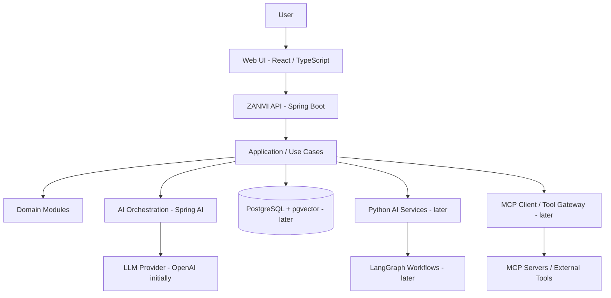
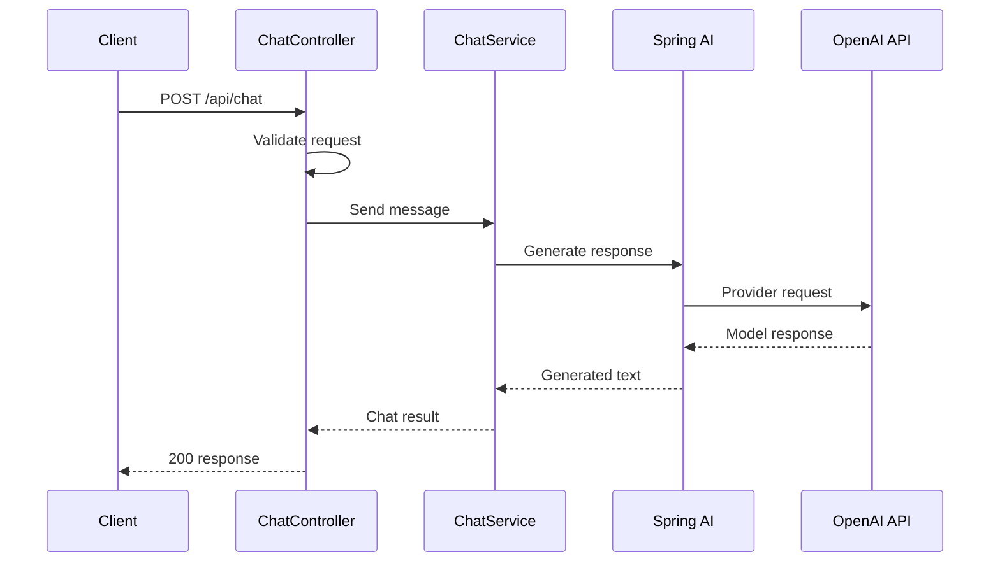

# ZANMI AI — Architecture & Repository Structure

**Repository:** `zanmi-ai`  
**Product:** ZANMI AI  
**Architecture style:** modular monolith initially, with separately deployable supporting services introduced only when justified.

## 1. Architecture goals

- Deliver useful personal-assistant capabilities incrementally.
- Keep the Java backend as the primary application and API boundary.
- Introduce Python for specialized AI workloads without duplicating core business logic.
- Separate model orchestration, retrieval, integrations, and user-facing APIs.
- Keep external tools permissioned, observable, and replaceable.
- Avoid distributed-system complexity before there is a clear need.

## 2. High-level logical architecture



The first release implements the Spring Boot API, application/service layer, Spring AI model call, and configuration. Other components are planned, not Sprint 1 dependencies.

## 3. Technology baseline and sequencing

| Concern | Initial direction | Introduced |
|---|---|---|
| Primary backend | Java 21+ / Spring Boot | Sprint 1 |
| LLM integration | Spring AI + OpenAI API | Sprint 1 |
| API | REST | Sprint 1 |
| Testing | JUnit 5, Spring Boot Test, Mockito as appropriate | Sprint 1 |
| Persistence | PostgreSQL | Knowledge release |
| Vector search | pgvector | Knowledge/RAG release |
| Document processing | Java first; Python where useful | Knowledge release |
| AI evaluation | Python tooling | Knowledge release |
| Frontend | React + TypeScript | After backend MVP |
| Identity | Keycloak | Before multi-user/secured deployment |
| MCP server | Python MCP SDK | MCP release |
| MCP client | Spring AI MCP client | MCP release |
| Agent orchestration | LangGraph | Agent release |
| A2A | A2A-compatible agent collaboration | Multi-agent release |
| Packaging | Docker Compose | After local baseline |
| Orchestration | Kubernetes / AKS | Deployment maturity stage |

Choose exact versions from current compatibility matrices when each component is implemented. Do not assume all components need to be deployed as separate microservices.

## 4. Logical module boundaries

### Java backend (`zanmi-backend`)
- `api`: REST controllers, request/response DTOs, exception mapping.
- `application`: use cases and orchestration.
- `domain`: core entities, value objects, and domain rules.
- `infrastructure`: LLM provider adapters, persistence adapters, external clients.
- `config`: Spring configuration and properties.
- `common`: shared cross-cutting utilities only where genuinely shared.

Potential future domain modules:
- `knowledge`
- `engineering`
- `learning`
- `productivity`
- `integrations`
Keep package boundaries explicit even while deployed as one application.

### Python AI services (`zanmi-ai-services`)
Future home for specialized processing and evaluation:
- document parsing/chunking experiments,
- offline RAG evaluation,
- model evaluation datasets and scripts,
- advanced agent workflow prototypes.
Do not create a Python service in Sprint 1.

### MCP servers (`zanmi-mcp-servers`)
Future home for purpose-built MCP servers:
- read-only knowledge search tools,
- selected repository inspection tools,
- approved productivity integrations.
Each server should expose a narrow set of tools with explicit schemas and least-privilege access.

### Frontend (`zanmi-frontend`)
Future React/TypeScript client:
- chat and conversation experience,
- document library and search,
- engineering/learning workspaces,
- task and workflow surfaces.
Not part of Sprint 1.

### Infrastructure (`infrastructure`)
Deployment and local development assets introduced progressively:
- Docker Compose,
- environment templates (never secrets),
- database initialization/migrations,
- Kubernetes manifests/Helm only when deployment requires them,
- scripts for repeatable developer workflows.

## 5. Repository directory structure

```text
zanmi-ai/
├── README.md
├── .gitignore
├── .editorconfig
├── .env.example
├── docs/
│   ├── PRD.md
│   ├── ARCHITECTURE.md
│   ├── USER-STORIES.md
│   ├── DEVELOPMENT-ROADMAP.md
│   ├── SPRINT-01-BACKLOG.md
│   ├── adr/
│   │   └── README.md
│   └── api/
│       └── README.md
├── zanmi-backend/
│   ├── pom.xml
│   ├── README.md
│   └── src/
│       ├── main/
│       │   ├── java/com/zanmi/ai/
│       │   │   ├── ZanmiAiApplication.java
│       │   │   ├── api/
│       │   │   │   └── chat/
│       │   │   ├── application/
│       │   │   │   └── chat/
│       │   │   ├── domain/
│       │   │   │   └── chat/
│       │   │   ├── infrastructure/
│       │   │   │   └── llm/
│       │   │   └── config/
│       │   └── resources/
│       │       └── application.yml
│       └── test/
│           └── java/com/zanmi/ai/
├── zanmi-ai-services/
│   ├── README.md
│   ├── pyproject.toml
│   ├── src/zanmi_ai_services/
│   └── tests/
├── zanmi-mcp-servers/
│   ├── README.md
│   └── servers/
│       └── README.md
├── zanmi-frontend/
│   ├── README.md
│   ├── package.json
│   └── src/
│       └── README.md
└── infrastructure/
    ├── README.md
    ├── docker/
    ├── kubernetes/
    └── scripts/
```

This is the **target repository layout**, not a requirement to implement every directory immediately. Empty future areas are represented with README or placeholder files so their intended purpose is clear.

## 6. Initial API contract

### Health
- `GET /actuator/health`
- Returns the application health status through Spring Boot Actuator.

### Chat
- `POST /api/chat`
- Request example:

```json
{
  "message": "Explain what a Spring Boot application context is."
}
```

- Response example:

```json
{
  "response": "The application context is..."
}
```

The exact DTO names and response metadata can evolve. Do not expose provider secrets or raw internal exception details.

## 7. Request flow for Sprint 1



## 8. Security and privacy

- Keep API keys in environment variables or a local secrets manager; `.env.example` contains placeholders only.
- Never commit `.env`, credentials, access tokens, or private user documents.
- Do not log authorization headers, API keys, or full personal content by default.
- Validate input size and content types.
- Treat uploaded documents, retrieved passages, repository content, and tool outputs as untrusted data—not system instructions.
- Do not allow arbitrary shell, filesystem, or SQL access through model-generated tool calls.
- Enforce authorization in application code, not by relying on prompt instructions.
- MCP tools should be allowlisted, narrowly scoped, and auditable.
- Require explicit user approval before consequential external actions.

## 9. Persistence and RAG design (future)

When the knowledge release begins:
- PostgreSQL stores users, document metadata, conversations, and processing state.
- pgvector stores embeddings and supports similarity retrieval.
- Original documents are stored through a controlled file/object-storage strategy.
- Chunk metadata records document ID, source name, page/section, and chunk position.
- Retrieval filters by authorization scope before content is passed to the model.
- Responses include traceable source references.

Evaluation should include a curated question set and measure Recall@K, faithfulness, citation correctness, latency, and cost.

## 10. Architecture decision records

Record significant choices in `docs/adr/` using a lightweight template:
- Context
- Decision
- Alternatives considered
- Consequences
- Date/status

Initial decisions to record:
1. Java/Spring Boot is the primary application backend.
2. Start as a modular monolith.
3. Keep repository name `zanmi-ai`; product brand is ZANMI AI.
4. Introduce Python, RAG, MCP, and agents progressively rather than in Sprint 1.
